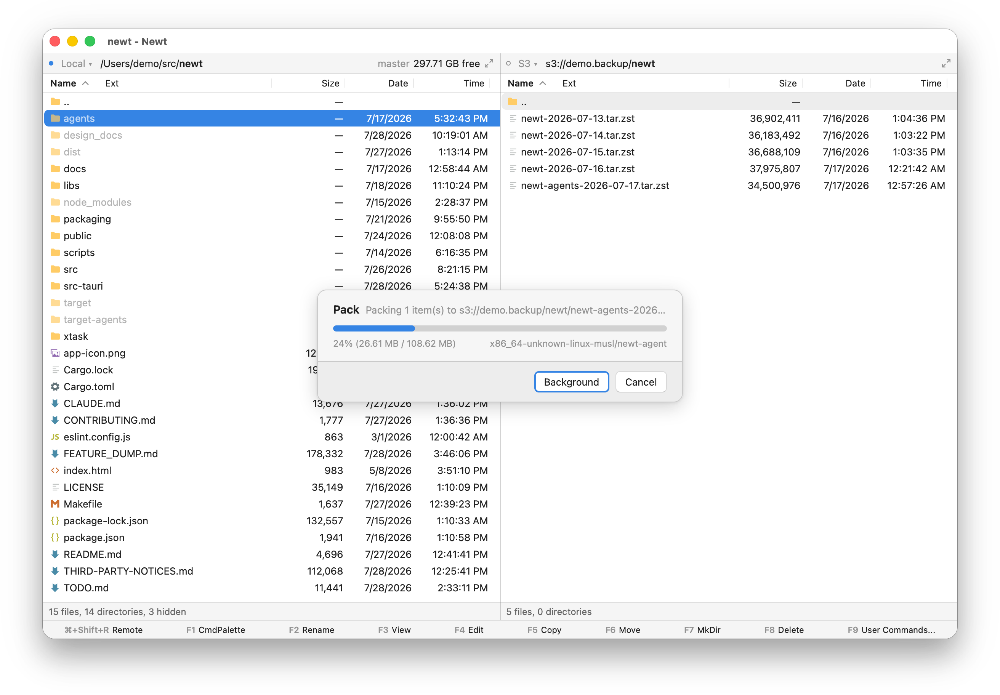

# Newt

*"If Altap Salamander and VS Code had a baby..."*

**[newt-fm.org](https://newt-fm.org)** — website, downloads and the user manual.

A keyboard-centric, dual-pane file manager for Linux, macOS and Windows in the orthodox
tradition — two panes, a terminal underneath, F-keys for everything — built with Tauri 2: a Rust
backend and a React/TypeScript frontend.



## Features

- **Two panes, one terminal** — side-by-side listings over a multi-tab terminal (xterm.js), with
  git status in the list and a `newt` command in the terminal that drives the panes
  (`newt cd`, `newt select`, `newt cp`, …).
- **Keyboard-first** — F-key operations, quick search by typing, a regex filter, a command
  palette, Go to File (Mod+G), and every command rebindable per context.
- **Remote sessions** — SSH, Docker, Podman, Kubernetes, WSL and elevated (pkexec / UAC)
  sessions run the whole app — panes, terminals, operations — on the other side through a small
  agent binary. Any of those can also be mounted in a single pane, and your own machine can stay
  reachable from a session (if you allow it), so local↔remote copies are just copies.
- **Virtual filesystems** — S3 (with ACLs, storage class and metadata) and SFTP; zip, 7z, tar
  and cpio archives and ISO/UDF disc images browsed in place, even when they live on S3. Find in
  Folder streams its results into a pane you can operate on like any directory.
- **File operations** — copy, move, delete, batch rename (regex, live preview) and pack to
  archive across any pair of filesystems, streaming end to end, with progress, conflict
  resolution and cancellation.
- **Viewer and editor** — F3 views text, tables, Markdown, hex, images, media, PDF and a
  structural dissection of some 1,600 formats, streaming remote files by range; Quick View
  previews them beside the list. F4 edits in Monaco.
- **Configurable** — file associations for Enter, F3 and F4; user commands as Jinja templates
  over the selection (F9); one hot-reloaded `settings.toml` behind the Settings dialog.

## How it fits together

- **Rust is the source of truth.** Session state lives in the Tauri process and is pushed to the
  frontend as patches (treediff → Immer); React renders it rather than owning it — dialogs
  included.
- **One code path, local or remote.** Filesystems, terminals and operations sit behind traits
  with a local implementation and a remote proxy that forwards each call over RPC to the agent.
  A local session and an SSH session are the same code; only the side of the RPC boundary doing
  the work differs.
- **Everything is a `Vfs`.** S3, SFTP, archives, disc images and search results mount into
  either side through one trait, and file operations are written once against it — so a copy
  from an archive on S3, inside a remote session, to the local disk is the ordinary path.

| Path | What's there |
|---|---|
| `src/` | Frontend: panes, terminal, dialogs, viewer and editor windows |
| `src-tauri/` | Tauri backend: windows, session state, command handlers, preferences |
| `libs/newt-common/` | Shared core: the traits and both implementations, RPC, VFS backends, operations |
| `libs/newt-agent/` | The agent binary for remote, elevated and WSL sessions |
| `libs/newt-archive/`, `libs/newt-disc/` | zip and 7z readers, zip / 7z / tar writers; ISO 9660 and UDF readers |
| `libs/pty-process/` | Vendored PTY crate (Unix) |
| `xtask/` | Build tasks: agents, TypeScript bindings, third-party notices |
| `packaging/` | deb, rpm, Arch, AppImage, macOS and MSI packaging |
| `docs/scenes/` | Scripted scenes behind the documentation screenshots |

## Building

You need Rust, Node.js and, on Linux, the WebKitGTK development packages
(`libwebkit2gtk-4.1-dev`, `librsvg2-dev` on Debian/Ubuntu).

```sh
npm install              # also installs the pre-commit hook
npm run tauri dev        # run the app
npm run tauri build      # release build
```

Remote, elevated and WSL sessions need agent binaries: `cargo xtask agents` builds them for every
target the host can produce (Linux agents cross-compile from any host with `cargo-zigbuild` and
zig 0.15). Other tasks: `cargo xtask gen-bindings` regenerates `src/lib/bindings.ts` after
changing a Tauri command or a type it carries, `cargo xtask notices` regenerates the third-party
notices, and `npm run screenshots` re-renders the documentation screenshots.

CI runs on every push to master:

```sh
cargo fmt --all --check && cargo clippy --workspace --all-targets -- -D warnings
cargo test --workspace
npx tsc --noEmit && npm run lint && npm test
cargo xtask gen-bindings --check
```

The pre-commit hook (also `git hook run pre-commit`) formats and lints what's staged and runs
clippy and the bindings check; the tests are left to you and CI.

Packaging for all three platforms is a manually triggered workflow.

## Documentation

- [CONTRIBUTING.md](CONTRIBUTING.md) — how contributions work here.
- [CLAUDE.md](CLAUDE.md) — architecture, invariants and footguns; read the relevant part before
  changing a subsystem. Written for coding agents, equally useful to people.
- [FEATURE_DUMP.md](FEATURE_DUMP.md) — exhaustive reference of what Newt does, from which the user
  manual is generated.
- [TODO.md](TODO.md) — known gaps and planned work.

## License

Licensed under the [GNU GPL v3.0](LICENSE) (GPL-3.0-or-later). Bundled dependencies and assets are
credited in [THIRD-PARTY-NOTICES.md](THIRD-PARTY-NOTICES.md) (`cargo xtask notices`), also
viewable in-app from the About box.
